# Vayle


Vayle is weekly pay for Stock Token holders on Robinhood Chain. Pick the price you'd sell your tokens at. Each week a buyer pays you for the right to buy them at that price when the market closes Friday. If the stock closes above it, your tokens sell at exactly your price. If not, you keep them and the payment, and it renews for another week.

NVDA is the first market. More Stock Tokens list as they pass the market check in [`tools/market-check`](tools/market-check).

The site is [vayle.xyz](https://vayle.xyz), and the app at [vayle.xyz/app](https://vayle.xyz/app/) runs on Robinhood Chain mainnet. Everything in this repository also runs end to end on a local fork of mainnet, and [Run it locally](#run-it-locally) starts one.

## On mainnet

Deployed at block 87,106,459, with NVDA, SPY and META listed. Every contract's source is verified on Sourcify, which the explorer reads.

| Contract                           | Address                                                                                                                                  |
| ---------------------------------- | ---------------------------------------------------------------------------------------------------------------------------------------- |
| VayleMarket                        | [`0x8d8f1E52848F9C2B04f091878D23DFed672bC78E`](https://robinhoodchain.blockscout.com/address/0x8d8f1E52848F9C2B04f091878D23DFed672bC78E) |
| StockTokenRegistry                 | [`0x3190A78bf4AB329eCBFdbc592c53d7A2E2ed69d8`](https://robinhoodchain.blockscout.com/address/0x3190A78bf4AB329eCBFdbc592c53d7A2E2ed69d8) |
| SessionCalendar                    | [`0x6A6F108fE00e59c7C58c3Bac0b6cBF20f87014a6`](https://robinhoodchain.blockscout.com/address/0x6A6F108fE00e59c7C58c3Bac0b6cBF20f87014a6) |
| PriceAdapter                       | [`0xdD45a6B8f8f0B71B50BEb56e0ad372bF7fA51671`](https://robinhoodchain.blockscout.com/address/0xdD45a6B8f8f0B71B50BEb56e0ad372bF7fA51671) |
| LivenessCheckpoint                 | [`0x0F78aE8654C797D8a2a81F78f055041711eac91a`](https://robinhoodchain.blockscout.com/address/0x0F78aE8654C797D8a2a81F78f055041711eac91a) |
| TimelockController, 8 days 6 hours | [`0xB717B143a5B28D4B7f897AA34f533D46f485B1C1`](https://robinhoodchain.blockscout.com/address/0xB717B143a5B28D4B7f897AA34f533D46f485B1C1) |
| Owner: a 2-of-3 Safe               | [`0x1D7bee7FDb39d5a3a319AA9975B590Dfa6a589E4`](https://robinhoodchain.blockscout.com/address/0x1D7bee7FDb39d5a3a319AA9975B590Dfa6a589E4) |

[`deployments/vayle-robinhood-mainnet.json`](deployments/vayle-robinhood-mainnet.json) is the record every service and the app build from. The [fallback page](https://vayle-fallback.timjosh507.workers.dev) reaches the market through your own wallet, without the site.

## What a holder does

There are two kinds of target, picked from the same ladder of prices around the token's last weekly close.

A sell target is a price above the close. It locks the tokens you'd sell. Each week the buyer pays you for the right to buy them at your price. If the stock closes above your price on Friday, your tokens sell at exactly your price. If it doesn't, you keep the tokens and the payment, and the target carries into the next week.

A buy target is a price below the close. It locks the USDG to pay for the tokens. Each week it's paid the same way. If the stock closes below your price on Friday, you buy at exactly your price.

Only Friday's close counts. A price reached during the week doesn't fill a target. Every target also has the least payment you'll take, and a week that pays less is skipped. You can change an idle target's price, amount and least payment in one transaction, stop it renewing, or cancel it. Payments and settled tokens wait in the market until you withdraw them, and a sell target can turn into a buy target at a price you set once it sells.

For developers, the mechanism is plain options. A sell target writes a physically settled covered call each week, and a buy target writes a cash-secured put. Both are European and fully collateralized, the weekly payment is the option premium, and exercise moves the actual Stock Token. The app presents them as weekly targets because that's how a holder thinks about selling at a price.

## How a week works

All times are New York time. The market keeps an onchain calendar of the exchange's closes, so early closes move the week with them, and a holiday Friday rolls back to the session before it.

| When                               | What happens                                                                                                                                                                                                                                                                                       |
| ---------------------------------- | -------------------------------------------------------------------------------------------------------------------------------------------------------------------------------------------------------------------------------------------------------------------------------------------------- |
| Friday's close, 4:00 PM            | The week opens. Its reference price is Chainlink's last round for the token at or before the close. Its targets sit one strike step apart within 10% of it, sells above and buys below, with a step of about 2% of the token's price. Last week's options can be exercised for the next two hours. |
| Two hours later                    | The bid window. For two hours the maker bids a payment for each price that has targets.                                                                                                                                                                                                            |
| After the bid window, until Sunday | The renewal batch writes every target at a price into the week at the best bid, one payment for everyone at that price, and pays it. Targets in a batch stay frozen until it settles. A price with no bid by Sunday 8:00 PM skips the week.                                                        |
| The rest of the week               | Targets hold. A new target can be paid before the next batch if the maker quotes it.                                                                                                                                                                                                               |
| The next Friday's close            | The maker exercises on the close. If the stock closed above a sell target, it sells at its price, and if it closed below a buy target, it buys at its price. Everything else expires. Settling hands back the tokens, the USDG or the proceeds, and a target that's still active renews.           |

A market's first week is shorter. It opens when the contracts are deployed instead of at a close, runs to the next Friday's close, and has no renewal batch, so targets are paid only by the maker's quotes. From that close on, every week runs as above.

## How it's built

Each of these is enforced by the contracts themselves.

- Every option is fully collateralized by the tokens or USDG it would deliver, locked in the market contract. There's no borrowing and nothing to liquidate.
- Settlement moves the actual tokens and never reads a price. The feed is read once a week, to set the week's prices, and the market refuses a round that's stale, paused, non-positive, or more than 50% from the last week's.
- The buyer is one maker run by the Vayle team. The market flags its address as team-operated, every fill says so onchain, and the app says so wherever a bid shows. Batch bids come only from makers the owner approves.
- Payouts are claims you pull. Payments, returned collateral and sale proceeds are credited to you, and you withdraw them when you like.
- A pause stops new targets and renewals but never settling, cancelling or withdrawing. An emergency halt stops everything for at most 72 hours at a time, only the timelocked owner can renew one, and windows stretch by however long a halt lasted.
- Robinhood Chain has no sequencer uptime feed, so the market keeps its own liveness checkpoints. A week opens only if the chain was live through the half hour before the close, and quiet time inside an exercise window extends it, up to a day.
- The owner is a timelock of 8 days and 6 hours, longer than a week and its window, run by a multisig. Every market, cap and setting it controls is fixed at deploy. The protocol fee starts at zero, can't go above 5% of the payment, and is paid by the maker on top, so a holder always gets the payment shown.
- Caps on open size, size per wallet, open interest per series and size per fill keep each market small while it's young. Each market's caps, grid and feed come from [`deployments/markets.json`](deployments/markets.json).
- Nothing needs Vayle's servers to get money out. The keeper and the maker only call functions anyone can call, and the [fallback page](apps/fallback) is one HTML file that lists, settles, cancels, withdraws and exercises through your own wallet.

## The pieces



[Mermaid source](docs/architecture.mmd)

| Folder                                     | What's there                                                                                               |
| ------------------------------------------ | ---------------------------------------------------------------------------------------------------------- |
| [`contracts`](contracts)                   | The market and the contracts around it, in Solidity with Foundry, and their unit, fork and invariant tests |
| [`apps/web`](apps/web)                     | The landing page and the holder app, served from a Cloudflare Worker                                       |
| [`apps/fallback`](apps/fallback)           | One HTML file for reaching the market through your own wallet when the app isn't there                     |
| [`services`](services)                     | The keeper, the team-operated maker, the watcher and the indexer                                           |
| [`packages`](packages)                     | Shared TypeScript: the market's calls and reads, chain facts, the session calendar, units, ABIs, the brand |
| [`tools/local-fork`](tools/local-fork)     | Runs the whole product on a local fork of mainnet, with the week on a simulated clock                      |
| [`tools/market-check`](tools/market-check) | Checks every Stock Token's feed, interfaces, pauses and liquidity before it can list                       |
| [`deployments`](deployments)               | The chain facts and the market registry every package reads, each with its source and block                |
| [`supabase`](supabase)                     | The tables the indexer and the watcher keep                                                                |

## Run it locally

The quickest way to see all of it is the local fork. It forks Robinhood Chain mainnet, deploys the production contracts with the production deploy script, funds a test holder with real NVDA and USDG from mainnet state, and runs the production keeper and maker on a simulated clock. You'll need Node 24, pnpm through Corepack, Foundry, and a Robinhood Chain RPC, which can be the chain's public one. [SETUP.md](SETUP.md) has the details.

```sh
corepack enable
pnpm install
cp .env.example .env                # set ROBINHOOD_RPC_URL
pnpm fork up                        # fork, deploy, fund the holder, open the first week
pnpm --filter @vayle/web dev:fork   # the app, pointed at the fork
pnpm fork advance                   # move to the next moment of the week
```

Add a network to your wallet with RPC URL `http://127.0.0.1:8545` and chain ID 4663, and import the holder key from `deployments/fork/accounts.json`. The holder starts with 10 NVDA and 10,000 USDG. Set a target, then run `pnpm fork advance` to watch the maker bid, the batch pay you, and the next close settle it. [tools/local-fork](tools/local-fork) explains each step and what on the fork is real.

## Checks

```sh
pnpm lint
pnpm typecheck
pnpm test
pnpm build
pnpm test:contracts
```

Fork tests run against real mainnet state and need `ROBINHOOD_RPC_URL`. CI runs every check on each push, plus Slither on the contracts and a scan that keeps private names and values out of the tree.

## Deploying

[DEPLOY.md](DEPLOY.md) is the runbook: the chain facts check, the contracts, the Workers, the database and the site.

## Security

Report a vulnerability privately to security@vayle.xyz, as [SECURITY.md](SECURITY.md) describes.

## License

MIT. See [LICENSE](LICENSE).
