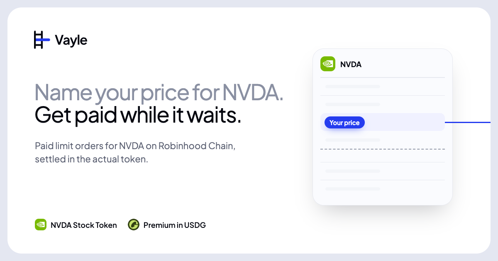
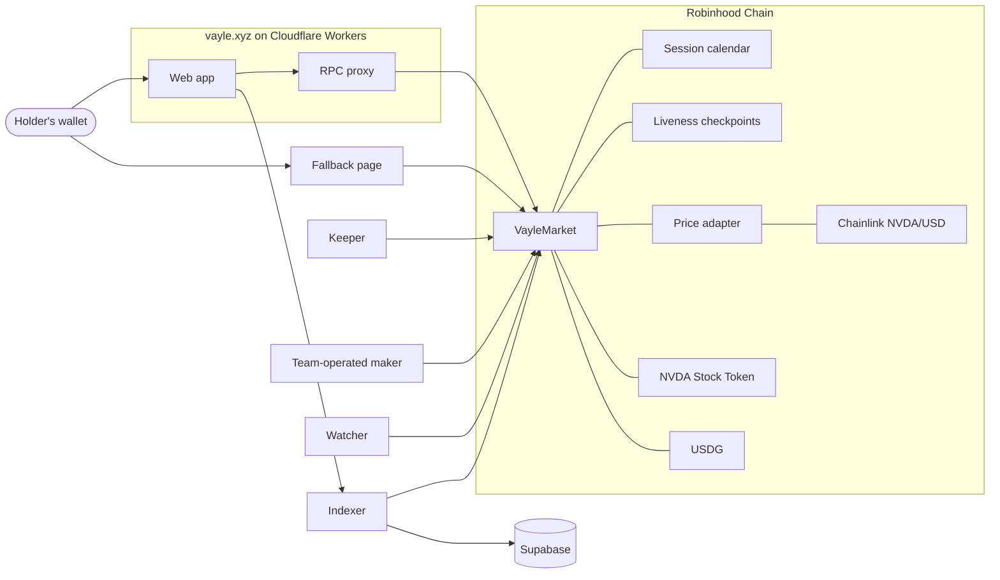

# Vayle



Vayle is paid limit orders for NVDA Stock Tokens on Robinhood Chain. You name the price you'd sell NVDA at, or buy it at. Every week your order does one of three things: it earns that week's premium, it skips the week, or it fills at exactly your price and the actual token changes hands. Then it renews, week after week, until it fills or you cancel it.

The site is [vayle.xyz](https://vayle.xyz). The contracts aren't deployed to mainnet yet, so the app there says it isn't open. Everything in this repository runs end to end on a local fork of Robinhood Chain mainnet, and [Run it locally](#run-it-locally) starts one.

## What a holder does

There are two kinds of order, picked from the same ladder of prices around NVDA's last weekly close.

A sell order sits at a price above the close. It locks the NVDA you'd sell. Each week the maker pays you a premium for the right to buy that NVDA at your price. If NVDA closes above your price at the next weekly close, the maker can buy it at exactly your price. If it doesn't, you keep the NVDA and the premium, and the order renews into the next week.

A buy order sits at a price below the close. It locks the USDG to pay for the NVDA. Each week it earns a premium the same way. If NVDA closes below your price, the maker can sell you NVDA at exactly your price.

Every order also has the least premium you'll take, and a week that bids less is skipped. You can change an idle order's price, amount and minimum in one transaction, stop it renewing, or cancel it. Premiums and settled tokens wait in the market until you withdraw them, and a sell order can turn into a buy-back order at a price you set once it sells.

In options terms, a sell order writes a covered call each week and a buy order writes a cash-secured put. Both are European, fully collateralized and physically settled. The app shows them as orders because that's how a holder thinks about selling at a price.

## How a week works

All times are New York time. The market keeps an onchain calendar of the exchange's closes, so early closes move the week with them, and a holiday Friday rolls back to the session before it.

| When                               | What happens                                                                                                                                                                                                                                                                                                         |
| ---------------------------------- | -------------------------------------------------------------------------------------------------------------------------------------------------------------------------------------------------------------------------------------------------------------------------------------------------------------------- |
| Friday's close, 4:00 PM            | The week opens. Its reference price is Chainlink's last NVDA/USD round at or before the close, and its prices sit $5 apart within 10% of it, sells above and buys below. Last week's options can be exercised for the next two hours.                                                                                |
| Two hours later                    | The bid window. For two hours the maker bids a premium for each price that has orders.                                                                                                                                                                                                                               |
| After the bid window, until Sunday | The renewal batch writes every order at a price into the week at the best bid, one price for everyone at that price, and pays the premiums. Orders that join a batch stay frozen until it settles. A price with no bid by Sunday 8:00 PM skips the week.                                                             |
| The rest of the week               | Orders hold. A new order can fill before the next batch if the maker quotes it.                                                                                                                                                                                                                                      |
| The next Friday's close            | The maker exercises what's worth exercising. If NVDA closed above a sell order's price, the order sells at its price, and if it closed below a buy order's price, the order buys at its price. Everything else expires. Settling hands back the collateral or the proceeds, and an order that's still active renews. |

## How it's built

Each of these is enforced by the contracts themselves.

- Every option is fully collateralized by the NVDA or USDG it would deliver, locked in the market contract. There's no borrowing and nothing to liquidate.
- Settlement moves the actual tokens and never reads a price. The feed is read once a week, to set the week's prices, and the market refuses a round that's stale, paused, non-positive, or more than 50% from the last week's.
- The maker that buys the options is run by the Vayle team. The market flags its address as team-operated, every fill says so onchain, and the app says so wherever a bid shows. Batch bids come only from makers the owner approves.
- Payouts are claims you pull. Premiums, returned collateral and fill proceeds are credited to you, and you withdraw them when you like.
- A pause stops new orders and renewals but never settling, cancelling or withdrawing. An emergency halt stops everything for at most 72 hours at a time, only the timelocked owner can renew one, and windows stretch by however long a halt lasted.
- Robinhood Chain has no sequencer uptime feed, so the market keeps its own liveness checkpoints. A week opens only if the chain was live through the half hour before the close, and quiet time inside an exercise window extends it, up to a day.
- The owner is a timelock of at least 8 days and 6 hours, longer than a week and its window, run by a multisig. The protocol fee starts at zero, can't go above 5% of the premium, and is paid by the maker on top, so a holder always gets the premium shown.
- Caps on open size, size per wallet, open interest per series and size per fill keep the market small while it's young.
- Nothing needs Vayle's servers to get money out. The keeper and the maker only call functions anyone can call, and the [fallback page](apps/fallback) is one HTML file that lists, settles, cancels, withdraws and exercises through your own wallet.

## The pieces



| Folder                                 | What's there                                                                                               |
| -------------------------------------- | ---------------------------------------------------------------------------------------------------------- |
| [`contracts`](contracts)               | The market and the contracts around it, in Solidity with Foundry, and their unit, fork and invariant tests |
| [`apps/web`](apps/web)                 | The landing page and the holder app, served from a Cloudflare Worker                                       |
| [`apps/fallback`](apps/fallback)       | One HTML file for reaching the market through your own wallet when the app isn't there                     |
| [`services`](services)                 | The keeper, the team-operated maker, the watcher and the indexer                                           |
| [`packages`](packages)                 | Shared TypeScript: the market's calls and reads, chain facts, the session calendar, units, ABIs, the brand |
| [`tools/local-fork`](tools/local-fork) | Runs the whole product on a local fork of mainnet, with the week on a simulated clock                      |
| [`deployments`](deployments)           | The chain facts every package reads, each with its source and the block it was checked at                  |
| [`supabase`](supabase)                 | The tables the indexer and the watcher keep                                                                |

## Run it locally

The quickest way to see all of it is the local fork. It forks Robinhood Chain mainnet, deploys the production contracts with the production deploy script, funds a test holder with real NVDA and USDG from mainnet state, and runs the production keeper and maker on a simulated clock. You'll need Node 24, pnpm through Corepack, Foundry, and a Robinhood Chain RPC with archive state. [SETUP.md](SETUP.md) has the details.

```sh
corepack enable
pnpm install
cp .env.example .env                # set ROBINHOOD_RPC_URL
pnpm fork up                        # fork, deploy, fund the holder, open the first week
pnpm --filter @vayle/web dev:fork   # the app, pointed at the fork
pnpm fork advance                   # move to the next moment of the week
```

Add a network to your wallet with RPC URL `http://127.0.0.1:8545` and chain ID 4663, and import the holder key from `deployments/fork/accounts.json`. The holder starts with 10 NVDA and 10,000 USDG. Place an order, then run `pnpm fork advance` to watch the maker bid, the batch pay the premium, and the next close settle it. [tools/local-fork](tools/local-fork) explains each step and what on the fork is real.

## Checks

```sh
pnpm lint
pnpm typecheck
pnpm test
pnpm build
cd contracts && forge test
```

Fork tests run against real mainnet state and need `ROBINHOOD_RPC_URL`. CI runs every check on each push, plus Slither on the contracts and a scan that keeps private names and values out of the tree.

## Deploying

[DEPLOY.md](DEPLOY.md) is the runbook: the chain facts check, the contracts, the Workers, the database and the site.

## Security

Report a vulnerability privately to security@vayle.xyz, as [SECURITY.md](SECURITY.md) describes.

## License

MIT. See [LICENSE](LICENSE).
