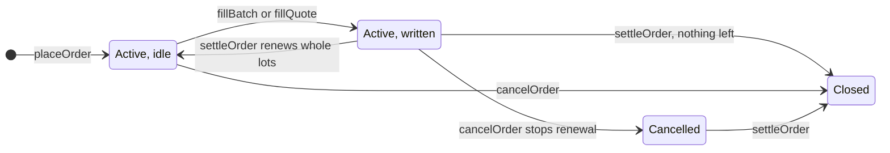
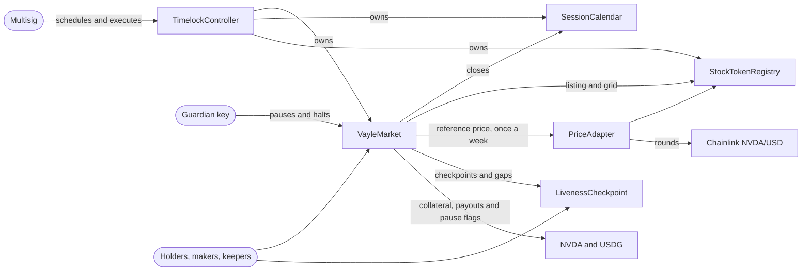

# Contracts

These are the contracts behind Vayle's weekly sell and buy targets on Stock Tokens. Underneath, a sell target writes a physically settled covered call each week and a buy target a cash-secured put, and the app calls the option premium the weekly payment. A holder names a price to sell a Stock Token at, or to buy it at, and locks the tokens or USDG the trade needs. Each week the market writes the order as a fully collateralized, physically settled option, and a maker buys it for a premium paid in USDG. If the maker exercises after the next close, the order fills at exactly its price and the actual token changes hands. If not, the collateral comes back and the order renews into the next week, until it fills or the holder cancels it.

The [root README](../README.md) explains the product. This one covers what each contract holds, the calls that run a week and who may make them, what the code guarantees and how it's tested. They're deployed on Robinhood Chain mainnet at the addresses in [`deployments/vayle-robinhood-mainnet.json`](../deployments/vayle-robinhood-mainnet.json), with their source verified on Sourcify. They're Solidity 0.8.37, built with Foundry through the IR pipeline at 200 optimizer runs for the cancun EVM version, as [`foundry.toml`](foundry.toml) sets, with OpenZeppelin Contracts v5.7.0 and forge-std v1.17.0 pinned in [`foundry.lock`](foundry.lock).

## Orders

| The holder's order   | `side` | Locks when placed                                  | Written each week as                     |
| -------------------- | ------ | -------------------------------------------------- | ---------------------------------------- |
| Sell NVDA at a price | `Call` | `size` raw units of NVDA                           | a call at that price, backed by the NVDA |
| Buy NVDA at a price  | `Put`  | the USDG to pay for `size` raw units at that price | a put at that price, backed by the USDG  |

The price is the order's `target`, and `minPremium` is the least premium per whole token it takes for a week. Each week one of three things happens.

- The order is written. The week's renewal batch, or a maker's signed quote mid-week, writes some or all of it into that week's series at a premium of at least `minPremium`, which is credited to the holder at once.
- The week is skipped. The best bid is under `minPremium`, nobody bids, the target isn't a listed strike that week, or the week never opened.
- The order fills. In the window after the next close the maker may exercise at exactly the series' strike, which is the order's target. A call exercise pays it in USDG for the NVDA, and a put exercise delivers NVDA for it.

Exercise is spread pro rata over every order written into a series. After the window, settling an order pays it its share of the collateral nobody exercised and of the exercise proceeds. An active order renews the returned collateral in whole lots, and the rest becomes claimable. With `flip` set, a filled order's proceeds open the opposite order at `flipTarget`, unless a pause, a halt, a delisting or a cap would refuse it.



Amounts are raw token base units, and prices, meaning strikes and premiums, are USDG base units per whole raw token, as [`Units.sol`](src/libraries/Units.sol) defines them. A corporate action like a split changes a Stock Token's UI multiplier and leaves raw balances alone, so it never changes what anyone owes. The registry only lists a grid where `lot * priceTick` divides evenly by the raw unit, so every settled value is an exact integer and `Units.valueExact` reverts instead of rounding. The deploy script lists NVDA with `LOT = 1e16` (0.01 NVDA, at its 18 decimals), `PRICE_TICK = 100` (0.0001 USDG, at its 6 decimals), `STRIKE_TICK = 5e6` (5 USDG) and `STRIKE_RANGE_BPS = 1000` (strikes within 10% of the reference price). The decimals come from the chain facts in [`deployments/robinhood-mainnet.json`](../deployments/robinhood-mainnet.json).

## The contracts

| Contract                                                    | Owner                         | What it holds                                                                                                                    |
| ----------------------------------------------------------- | ----------------------------- | -------------------------------------------------------------------------------------------------------------------------------- |
| [`VayleMarket`](src/VayleMarket.sol)                        | the timelock, plus a guardian | Orders and collateral, epochs, options as ERC-1155 longs, quotes, the renewal batch, settlement, payouts, pauses, halts and caps |
| `TimelockController`                                        | itself, run by a multisig     | OpenZeppelin's timelock. It owns the market, the calendar and the registry, so every owner action waits out its delay.           |
| [`SessionCalendar`](src/calendar/SessionCalendar.sol)       | the timelock                  | The weekly closes, each with its deadline for opening a week                                                                     |
| [`StockTokenRegistry`](src/assets/StockTokenRegistry.sol)   | the timelock                  | Listed Stock Tokens with their feed and grid, plus USDG and its decimals                                                         |
| [`PriceAdapter`](src/assets/PriceAdapter.sol)               | none                          | A week's reference price, from a Chainlink round it proves is the last one at or before the close                                |
| [`LivenessCheckpoint`](src/liveness/LivenessCheckpoint.sol) | none                          | Every stretch longer than `GAP_THRESHOLD`, 5 minutes, in which nobody checkpointed the chain                                     |



The market holds the calendar, the registry, the adapter and the liveness contract as immutables and takes USDG from the registry when it's built, so swapping any of them means deploying a new market. Nothing here is upgradeable.

## Inside VayleMarket

`VayleMarket` is one contract built from abstract modules, each extending the one below it.

| Module                                              | Built on                   | What it owns                                                                   |
| --------------------------------------------------- | -------------------------- | ------------------------------------------------------------------------------ |
| [`VayleMarket`](src/VayleMarket.sol)                |                            | The constructor, which sets the fee to zero, and `seriesFor`                   |
| [`MarketGuard`](src/core/MarketGuard.sol)           | `Ownable2Step`             | Owner and guardian, pauses, emergency halts and caps                           |
| [`RenewalBatch`](src/core/RenewalBatch.sol)         |                            | Bids, the batch bidder list, weekly batches and the freeze on orders they hold |
| [`QuoteSettlement`](src/core/QuoteSettlement.sol)   | `EIP712`                   | Signed quotes and fills, the fee, the team-operated flag and nonces            |
| [`SettlementEngine`](src/core/SettlementEngine.sol) |                            | The exercise window, `exercise`, `finalize` and the issuer pause log           |
| [`CollateralVault`](src/core/CollateralVault.sol)   |                            | Orders, one collateral pool per series, claimable balances and size totals     |
| [`EpochBook`](src/core/EpochBook.sol)               | `ReentrancyGuardTransient` | Links to the other contracts, epochs, listed strikes and close observations    |
| [`OptionSeries`](src/core/OptionSeries.sol)         | `ERC1155Supply`            | Series terms and long balances                                                 |

Lower modules reach rules they can't implement through abstract hooks such as `_requireNotHalted`, `_requireFillsOpen`, `_checkPlacement` and `_checkFillCaps`, which `MarketGuard` implements, while `RenewalBatch` implements the freeze checks. Each rule lives in one place, and every entry point a holder, maker or keeper uses shares one reentrancy guard.

A series ID is `uint256(keccak256(abi.encode(key)))` over a [`SeriesKey`](src/libraries/SeriesId.sol) holding every term: chain ID, asset, call or put, strike, expiry, window length, unit basis, exercise style, settlement type, collateral token and collateral mode. A long's balance is the raw amount of the underlying it covers. Longs transfer freely, and writers hold orders in the vault instead of tokens.

## A week, call by call

A week runs between two closes in the calendar. Below, C is the close it opens at and E is the next one, its expiry.

| When                                                       | What the market accepts                                                                    |
| ---------------------------------------------------------- | ------------------------------------------------------------------------------------------ |
| The 30 minutes up to C                                     | `observeClose`. A liveness gap in this stretch refuses the week.                           |
| After C, until the Monday 09:30 ET after it                | `createEpoch` for the week from C to E                                                     |
| From C, for 2 hours of usable time                         | `exercise` on last week's series, then `finalize` and `settleOrder` once its window closes |
| 2 hours after C, until the batch deadline, Sunday 20:00 ET | `submitBid`, while idle orders at the week's listed strikes are frozen                     |
| 4 hours after C, until the batch deadline                  | `openBatch` and `countBatch`                                                               |
| Once a batch is sealed, until E                            | `fillBatch`, even after the deadline                                                       |
| Until E                                                    | `fillQuote` on orders that aren't frozen                                                   |
| From E, for 2 hours of usable time                         | `exercise` on this week's series, then `finalize`, `settleOrder` and the next batch        |

Placing, changing, cancelling and withdrawing work at any time, within the limits below.

### Opening the week

| Call                                           | Who may call | What it does                                                                                                                                                |
| ---------------------------------------------- | ------------ | ----------------------------------------------------------------------------------------------------------------------------------------------------------- |
| `checkpoint()` on `LivenessCheckpoint`         | anyone       | Records a gap when more than `GAP_THRESHOLD` has passed since the last checkpoint. The market's order, fill, batch, epoch and settlement calls do it first. |
| `observeClose(asset)`                          | anyone       | In the `LIVENESS_LOOKBACK`, 30 minutes, before a close, records whether the token's `oraclePaused()` flag is set                                            |
| `createEpoch(asset, roundHint)`                | anyone       | Opens the week from the latest close C to the next close E                                                                                                  |
| `createFirstEpoch(asset, roundHint)`           | anyone       | Before the schedule's first close only: opens the asset's first week now, running to that close, with no batch                                              |
| `seriesFor(asset, expiry, optionType, strike)` | anyone       | Registers the series at a listed strike, which every fill needs first                                                                                       |

`createEpoch` refuses after the creation deadline, after a liveness gap in the 30 minutes before C, and unless the close observations found the oracle clear, with one in the last `CLOSE_OBSERVATION_RECENCY`, 5 minutes. [`PriceAdapter.referencePrice`](src/assets/PriceAdapter.sol) then takes the caller's round only if it's provably the feed's last round at or before C, positive, and no more than `MAX_AGE_AT_CLOSE`, 24 hours, old at C, with the token listed, its oracle flag clear and the feed's decimals unchanged. When the previous week opened within `REFERENCE_RECENCY`, 8 days, a price below half or above one and a half times its reference is refused too. So the caller can't pick a convenient price.

`createFirstEpoch` covers the days between the deploy and the schedule's first close, when there's no close to open a week at. The week opens at the moment of the call and runs to the first close. It holds the same liveness standard, with the 30-minute lookback falling after the market's `deployedAt`, reads the oracle flag directly, and takes the feed's last round at or before the second before the opening as its reference. Its batch deadline is its opening, so no bid, batch or freeze happens that week, and targets are paid only by quotes. Once the first close passes it reverts `FirstCloseHasPassed`, for every asset.

The epoch copies the reference price, the asset's grid, the 2-hour `WINDOW_LENGTH` and its batch deadline, so later registry or calendar changes can't reach a live week. Its listed strikes sit on the strike tick, out of the money at C and within `strikeRangeBps` of the reference. A week nobody opens before its deadline is skipped, and idle orders wait.

### Writing orders by quote

`fillQuote(quote, signature, orderId, amount)` writes part or all of one order at a maker's quote, and anyone may send it. The maker signs an EIP-712 `Quote`, checked with OpenZeppelin's `SignatureChecker` so contract makers can sign through ERC-1271. It names the series, the premium per whole token, the highest fee rate the maker accepts, the most it buys and the least per fill, a nonce, a deadline no later than expiry, and optionally the one holder it's for. The fill refuses a frozen order, a halted market, an asset that's paused, delisted or has its oracle flag set, a premium under the order's minimum and anything over a cap. It takes the premium and the fee from the maker, credits the holder and the fee recipient, and mints the longs last. A maker withdraws quotes with `cancelQuote` or `invalidateNonces`.

### The renewal batch

Standing orders renew through one batch per series, over the bucket of orders with its asset, side and strike.

| Call                          | Who may call                                 | What it does                                                                                                                                                                                                                |
| ----------------------------- | -------------------------------------------- | --------------------------------------------------------------------------------------------------------------------------------------------------------------------------------------------------------------------------- |
| `submitBid(quote, signature)` | anyone, for a maker on the batch bidder list | Publishes a signed bid on one of this week's series as `BidSubmitted`. The highest premium is the best bid, an earlier bid wins a tie, and a submitted quote can't also fill by `fillQuote`.                                |
| `openBatch(series)`           | anyone                                       | Starts the batch once `BID_WINDOW`, 2 hours, of bidding has passed, while fills are open, with a best bid and every order attached to last week's series in the bucket settled                                              |
| `countBatch(series, ids)`     | anyone                                       | Counts the bucket's idle orders in increasing ID, in chunks, skipping any whose minimum is over the bid (`OrderSkipped`). The last chunk seals the batch and takes the maker's premium and fee on its capacity into escrow. |
| `fillBatch(series, ids)`      | anyone                                       | Writes each eligible order at the best bid by the same fraction of its size, credits its premium and mints longs to the maker. The last chunk pays the fee and returns unused escrow.                                       |
| `closeBatch(series)`          | anyone                                       | Ends a sealed batch that can't fill, after the deadline while fills are refused or once the series has expired                                                                                                              |

Capacity is the smallest of the bid's amount, the eligible size and the series cap's room, in whole lots. Counting has to cover the whole bucket in order before anything fills, and one fraction fixed at the seal applies to every order, so whoever runs the batch can't leave a holder out or favor one. From the bid window's opening until the batch is done, or until the deadline if it never sealed, the bucket's idle orders are frozen. `updateOrder`, `amendOrder`, `cancelOrder` and `fillQuote` refuse them, and `amendOrder` can't move an order into a frozen bucket. An order whose target isn't listed this week has no batch and isn't frozen. New orders can still be placed, and an open batch leaves them out.

### Changing an order

| Call                                            | Who may call                  | What it does                                                                                                                                                                        |
| ----------------------------------------------- | ----------------------------- | ----------------------------------------------------------------------------------------------------------------------------------------------------------------------------------- |
| `placeOrder(params)`                            | anyone, who becomes its owner | Takes the full collateral and opens an order, unless the market is paused or halted, the asset isn't listed, the terms are off the grid or a cap would be exceeded                  |
| `updateOrder(id, minPremium, flip, flipTarget)` | the owner                     | Changes the minimum and the flip settings, also while the order is written                                                                                                          |
| `amendOrder(id, params)`                        | the owner                     | Gives an idle order a new target, size, minimum and flip settings under the same ID, with every check a new order faces, and moves only the collateral difference                   |
| `cancelOrder(id)`                               | the owner                     | Makes idle collateral claimable at once. A part written into this week's series comes back when it settles, without renewing, which is how a holder stops a written order renewing. |

### Exercise and settlement

| Call                       | Who may call            | What it does                                                                                                    |
| -------------------------- | ----------------------- | --------------------------------------------------------------------------------------------------------------- |
| `exercise(series, amount)` | whoever holds the longs | Burns them in the window. A call pays the strike in USDG for the NVDA, and a put delivers NVDA for the strike.  |
| `observePauses(asset)`     | anyone                  | Records whether the token, its access registry or USDG is paused by its issuer, as `exercise` and `finalize` do |
| `finalize(series)`         | anyone                  | Closes the series after its window. Longs nobody exercised expire.                                              |
| `settleOrder(id)`          | anyone                  | Pays an order its share of a finalized series and renews it                                                     |
| `withdraw(token, amount)`  | the account that's owed | Sends the caller's own claimable balance                                                                        |

The window opens at expiry and closes once `windowLength`, 2 hours, of usable time has passed. Liveness gaps, up to `LIVENESS_EXTENSION_CAP`, 24 hours, in total, issuer pauses and emergency halts don't count, and overlaps count once. A gap is only recorded by the first checkpoint after it, so `windowEnd(series)` can move later until `finalize` closes the series. `settleOrder` then gives each order `collateral * shares / remainingShares` of the pool and the same share of the proceeds, rounded down, and the last order to settle takes what's left, so the pool always ends at zero.

## Roles

### Owner

The deploy script makes a `TimelockController` the owner of the market, the calendar and the registry, with a multisig as its only proposer, canceller and executor, and refuses a delay under `MIN_TIMELOCK_DELAY`, 8 days and 6 hours, which is longer than the longest week plus its window. These are the owner's functions.

| Contract             | Function                               | Limit                                                                                                                                                                                                                         |
| -------------------- | -------------------------------------- | ----------------------------------------------------------------------------------------------------------------------------------------------------------------------------------------------------------------------------- |
| `VayleMarket`        | `setFee(feeBps, recipient)`            | At most `MAX_FEE_BPS`, 500 basis points. A fill refuses a rate above the `maxFeeBps` its maker signed, and a batch keeps the rate it sealed with.                                                                             |
| `VayleMarket`        | `setCaps(asset, side, caps)`           | Only checked when exposure grows                                                                                                                                                                                              |
| `VayleMarket`        | `setTeamOperated`, `setBatchBidder`    | The two maker flags below                                                                                                                                                                                                     |
| `VayleMarket`        | `setGuardian(guardian)`                | Never the zero address                                                                                                                                                                                                        |
| `VayleMarket`        | `renewHalt()`                          | Extends the active halt to 72 hours from now, or starts a new one                                                                                                                                                             |
| `VayleMarket`        | `transferOwnership`, `acceptOwnership` | Two steps, and `renounceOwnership` reverts                                                                                                                                                                                    |
| `SessionCalendar`    | `append(boundaries)`, `truncate(keep)` | Only closes more than `MIN_LEAD`, 1 day, away can be added or removed, the next close can't be removed, and each close and deadline must be plausible. The schedule the constructor takes only needs its closes in the future |
| `StockTokenRegistry` | `list(...)`, `delist(token)`           | Listing checks the token's `uid()`, its ERC-8056 interfaces and oracle flag, a working feed and an exact grid. Delisting stops new weeks, orders and fills.                                                                   |

The calendar and the registry also keep OpenZeppelin's `Ownable2Step` transfer and renounce functions. None of these functions moves a token or writes an order, a series, a pool or a claim.

### Guardian

The guardian is a separate key whose only functions are `setPaused`, `setAssetPaused`, `halt` and `endHalt`.

A pause, for the whole market or one asset, refuses new exposure only. `placeOrder`, `amendOrder`, `fillQuote`, `openBatch` and `fillBatch` revert with `MarketPaused`, and a flip credits its proceeds instead. `cancelOrder`, `settleOrder`, `withdraw`, `exercise` and `finalize` have no pause check.

A halt stops nearly everything for `HALT_DURATION`, 72 hours. Placing, updating, amending, cancelling, settling and withdrawing revert with `MarketHalted`, and so do `createEpoch`, `fillQuote`, `openBatch`, `fillBatch`, `closeBatch`, `exercise` and `finalize`. Checkpoints, close and pause observations, `seriesFor`, `submitBid`, `countBatch`, quote cancellations and transfers of longs still work. The guardian can end a halt early but can't extend one, and can't start another until `GUARDIAN_HALT_COOLDOWN`, 72 hours, after the last one ended. Only the owner's `renewHalt()` keeps a halt going. Halted time counts as dead time in every exercise window, so a halt pushes a window's end out by as long as it lasted.

### Makers

Any address can be a maker and sign quotes that fill orders through `fillQuote`. Two owner-set flags apply to makers, and the deploy script sets both for `TEAM_MAKER`, the [team's maker](../services/maker/README.md).

- `teamOperated[maker]` marks a maker the Vayle team runs. `QuoteFilled` carries it on every quote fill, and `BatchOpened` carries it for the maker whose bid a batch fills at.
- `batchBidder[maker]` lists the makers whose bids a batch accepts, and `submitBid` refuses anyone else with `NotABatchBidder`. A batch pulls its best bidder's escrow when it seals, so a bid from a maker who can't or won't pay would stall the week for its bucket.

### Keepers

There's no keeper role. Every call that moves a week along is public: `checkpoint`, `observeClose`, `createEpoch`, `observePauses`, `finalize`, `settleOrder`, `openBatch`, `countBatch`, `fillBatch` and `closeBatch`. The [keeper](../services/keeper/README.md) sends exactly these from a key that holds gas only, and the [fallback page](../apps/fallback/README.md) offers `checkpoint` and `observeClose` to anyone. If nobody calls them, a week can be skipped or run late, and every exit still works for whoever sends it.

## What the code enforces

- Full collateral. `placeOrder` pulls the whole collateral, `size` raw units of the token for a sell order and `Units.valueExact(size, target, rawUnit)` USDG for a buy order. `_commit` moves exactly the written part into the series' pool, and longs are minted only by `fillQuote` and `fillBatch`, after `_commit`. There's no borrowing and no liquidation code, and `_pull` reverts with `UnexpectedTransferAmount` if a token delivers anything but the amount asked.
- Premium before options. `fillQuote` collects the premium and the fee before it mints, and a batch takes its whole escrow when it seals, before any order fills.
- No oracle read at settlement. `exercise`, `finalize`, `settleOrder` and `withdraw` read no price feed, no oracle flag and no registry entry. The feed is read only through `PriceAdapter`, from `createEpoch`, to place strikes, and `_exercise` takes its units from the epoch's copy of the grid, so delisting can't block an exercise.
- Pull-based payouts. Premiums, fees, returned collateral, exercise proceeds, deliveries to an exerciser and refunded escrow are all credits to `claimable[owner][token]`. The only token transfer out of the market is in `withdraw`, which sends the caller's own balance, so an account a token's issuer blocks can only hold up its own claim.
- A pause never blocks an exit. Pause flags are read only by `MarketGuard`'s placement and fill checks, which `cancelOrder`, `settleOrder`, `withdraw`, `exercise` and `finalize` don't call. `test_aPauseNeverBlocksExits` and `test_everyExitWorksWithAPauseThatNobodyCanLift` check it.
- Liveness gaps extend windows. Robinhood Chain has no sequencer uptime feed, so `LivenessCheckpoint` keeps its own record, starting at deployment. Every market call that changes an order, a fill, a batch, an epoch or a settlement checkpoints first, and so does `withdraw`. `_windowEnd` doesn't count gap time inside a window, up to `LIVENESS_EXTENSION_CAP`, and `createEpoch` refuses a week with any gap in the `LIVENESS_LOOKBACK` before its close.
- Caps. `MarketGuard.Caps` holds four limits per asset and side, in raw units of the underlying. `_checkPlacement` checks `openSize` and `walletSize` on placing and amending, `_checkFillCaps` checks `fillSize` and `seriesOpenInterest` on quote fills, and `_batchLimits` bounds a batch. Caps start at zero, so a side stays closed until the owner sets them, and lowering one never touches a written series.
- Exact amounts and fees. `Units.valueExact` reverts instead of rounding, `Units.fee` rounds up since the maker pays it on top, and the holder is credited exactly the premium. Pro-rata shares round down, and the last order to settle takes the remainder.
- No replayed quotes. The EIP-712 domain is `Vayle`, version `1`, with the chain ID and the market's address, `quoteFilled[digest]` stops a quote at its `maxAmount`, and its deadline can't pass the series' expiry.
- No reentry. Every holder, maker and keeper entry point is `nonReentrant` on one `ReentrancyGuardTransient` guard, and mints to a maker come after every state change.
- Issuer pauses can't brick settlement. `_isPaused` treats a probe of the token, its access registry or USDG that fails or answers anything but true as not paused, so a token upgrade that drops a flag only stops pauses being recorded.

## Tests

| Folder                                                            | What it covers                                                                                                      | Needs                                                            |
| ----------------------------------------------------------------- | ------------------------------------------------------------------------------------------------------------------- | ---------------------------------------------------------------- |
| `test/libraries`, `test/calendar`, `test/liveness`, `test/assets` | Units, series IDs, session rules, the calendar and gap accounting, with fuzzing, and ERC-8056 interface IDs         | nothing                                                          |
| `test/Deployables.t.sol`                                          | Code sizes against the chain's limits                                                                               | nothing                                                          |
| `test/fork`                                                       | Each module on real NVDA, USDG and the NVDA/USD feed, and the deployable market's roles, pauses, halts and caps     | `ROBINHOOD_RPC_URL`                                              |
| `test/campaigns`                                                  | Randomized lifecycles, invariants and adversarial cases on the deployable market                                    | `ROBINHOOD_RPC_URL`                                              |
| `test/deploy`                                                     | The deploy script on mainnet state, its end state, and a week on what it deployed                                   | `ROBINHOOD_RPC_URL`                                              |
| `test/interface`                                                  | A holder's whole flow sent through the call builders in [`packages/market`](../packages/market/README.md), over FFI | `ROBINHOOD_RPC_URL`, `pnpm install`, `FOUNDRY_PROFILE=interface` |

Fork tests run on Robinhood Chain mainnet state with no mocked tokens or feeds. [`ForkTest`](test/utils/ForkTest.sol) forks the latest block, or `FORK_BLOCK` when it's set, takes every address from the chain facts, and fails with a named error instead of falling back to anything. Wallets are funded by impersonating a real holder, and issuer actions such as pauses and multiplier updates come from the real role holders in [`ChainActors`](test/utils/ChainActors.sol). [`MarketFork`](test/utils/MarketFork.sol) warps back before recent Friday closes so the calendar can hold them, then prices them from the feed's real rounds.

Four campaigns are randomized.

- [`LifecycleCampaign`](test/campaigns/LifecycleCampaign.fork.t.sol). Each fuzz run is a whole week of up to four orders, filled in part at random premiums under a fee of up to 5%, then cancelled, exercised in part, settled and withdrawn. The checks read balances. The market has to end empty, the maker has to have paid exactly its premiums, fees and strikes, and each order has to get at least the floor of its pro-rata share.
- [`MarketInvariants`](test/campaigns/MarketInvariants.fork.t.sol). Random sequences of holder, maker, keeper and guardian actions. After every call it checks token conservation, the size and bucket totals, full backing of each series, the caps, and that nothing went through during a halt and nothing grew during a pause.
- [`VaultInvariants`](test/fork/VaultInvariants.fork.t.sol). The same kind of campaign on the vault alone.
- [`RenewalCampaign`](test/campaigns/RenewalCampaign.fork.t.sol). Random batches, checked order by order against a pro-rata share worked out from the plan alone, plus the flip cases.

The default profile runs the lifecycle campaign 512 times, the renewal campaign 256 times and each invariant campaign 24 times with 40 calls, and `FOUNDRY_PROFILE=ci` raises those to 4,096, 1,024 and 256 with 64 calls, as each test's `forge-config` lines set.

Four more run fixed cases. [`AdversarialSettlement`](test/campaigns/AdversarialSettlement.fork.t.sol) tries double exercise, replayed and expired quotes, wrong series and tokens, donated tokens, reentry from a maker contract, window boundaries to the second, dust and fills at the caps. [`CorporateActions`](test/campaigns/CorporateActions.fork.t.sol) runs 2-for-1, reverse and 4-for-1 multiplier changes through NVDA's real multiplier updater, an issuer pause in the window, a delisting and an oracle pause, and every raw entitlement survives. [`TwoWeekRenewal`](test/campaigns/TwoWeekRenewal.fork.t.sol) renews two orders across two real weekly closes. [`Continuity`](test/campaigns/Continuity.fork.t.sol) runs with no keeper or service at all, and holders still exit with logs, views and calls alone, even under a pause nobody lifts.

```sh
cd contracts
forge build
forge test --match-path 'test/{libraries,calendar,liveness,assets}/*'  # no network
forge test --match-path test/Deployables.t.sol                         # code sizes, no network
forge test                                                             # all but test/interface
FOUNDRY_PROFILE=ci forge test                                          # with CI's run counts
FOUNDRY_PROFILE=interface forge test --match-path 'test/interface/*'
```

The fork suites read `ROBINHOOD_RPC_URL` from the environment, an RPC with archive state as [SETUP.md](../SETUP.md) describes. The interface suite runs `node` over FFI, so it needs `pnpm install` at the repo root first. CI runs `forge fmt --check`, `forge lint`, `forge build`, the ABI check from [`packages/abi`](../packages/abi/README.md), `forge test` under the ci profile, the interface suite and static analysis.

## Deploying

[`script/DeployVayle.s.sol`](script/DeployVayle.s.sol) deploys everything from one key and leaves that key with no role. It reads NVDA, its uid, its feed and USDG from the chain facts, the boundaries from `deployments/calendar-boundaries.json` and the rest from the environment, and refuses a multisig with no code, a delay under `MIN_TIMELOCK_DELAY` or an empty schedule. It deploys a `TimelockController` at zero delay with the deployer as its proposer and executor, then the other five contracts. One timelock batch lists NVDA on the grid above, appends the boundaries, sets both sides' caps, flags the team maker as team-operated and a batch bidder, and raises the delay. The script then gives the multisig the proposer, canceller and executor roles, renounces all of the deployer's, and only on a broadcast writes the addresses to `deployments/vayle-robinhood-mainnet.json`. [`DeployFork.s.sol`](script/DeployFork.s.sol) points the same deploy at `deployments/fork/` for the [local fork](../tools/local-fork/README.md), and [`DeployVayle.fork.t.sol`](test/deploy/DeployVayle.fork.t.sol) rehearses it on mainnet state. [DEPLOY.md](../DEPLOY.md) is the runbook.

## Code size

The chain's limits are `chain.maxCodeSize`, 98,304 bytes, and `chain.maxInitCodeSize`, 196,608 bytes, in [`deployments/robinhood-mainnet.json`](../deployments/robinhood-mainnet.json), which the [chain facts](../packages/chain-facts/README.md) script measured by bisecting contract creations on chain. `foundry.toml` sets `code_size_limit` to the same 98,304. [`test/Deployables.t.sol`](test/Deployables.t.sol) reads both limits from that file and checks each Vayle contract the script deploys, its runtime against the first and its initcode plus seven 32-byte constructor arguments against the second.

Sizes as of the build at commit `d100d54`, from `forge build --sizes`:

| Contract                             | Runtime (bytes) | Initcode (bytes) |
| ------------------------------------ | --------------- | ---------------- |
| `VayleMarket`                        | 40,450          | 42,239           |
| `StockTokenRegistry`                 | 3,136           | 3,543            |
| `SessionCalendar`                    | 2,811           | 3,029            |
| `PriceAdapter`                       | 2,339           | 2,472            |
| `LivenessCheckpoint`                 | 1,272           | 1,324            |
| `TimelockController`, OpenZeppelin's | 5,448           | 6,753            |

`forge build --sizes` compares against its own 24,576-byte default from EIP-170 and exits with an error because of the market. Take the sizes from it and the verdict from `Deployables.t.sol`.
